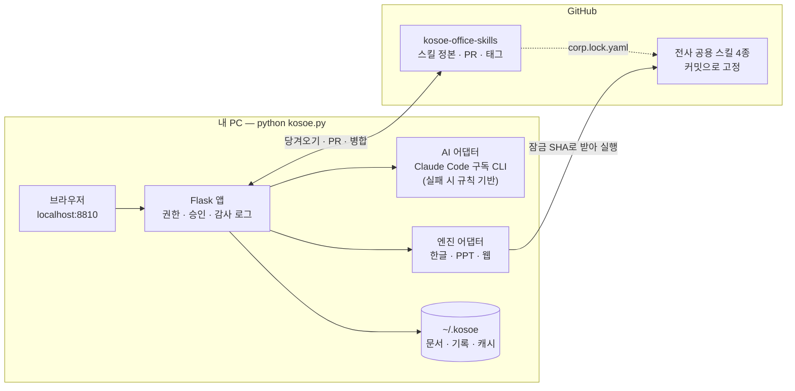
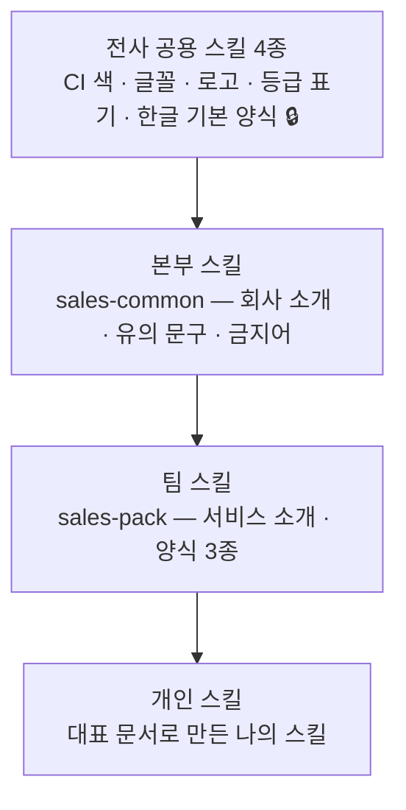

<div align="center">


# 코쇠오피스 (Kosoe Office)

**회사 양식에 맞춰 PPT · 웹슬라이드 · 한글 문서를 만들고, 수정과 검수까지 이어 주는 사내 문서 도우미**

대표 문서 몇 건이면 전사 공용 스킬을 상속한 **우리 부서 · 나의 스킬**이 생기고, 그 스킬은 Git 저장소에서 버전과 승인으로 관리됩니다.


[빠른 시작](#빠른-시작) · [사용법](#사용법) · [3분 시연](#3분-시연-따라-하기) · [동작 방식](#동작-방식) · [스킬 저장소 ↗](https://github.com/humanist96/kosoe-office-skills)


▶ [2분 53초 시연 영상 보기](docs/demo.mp4) (실제 화면 녹화, 대기 구간은 빨리 감기)

</div>

---

## 무엇을 해결하나요

AI가 초안을 써 줘도 **형식마다 다시 쓰기**(PPT·웹·한글), **부서마다 다른 양식·용어 맞추기**, **바뀐 기준 반영하기**, **수정 누락 확인하기**는 여전히 사람 몫입니다. 코쇠오피스는 이 네 가지를 한 흐름으로 잇습니다.

| 하는 일 | 어떻게 |
|---|---|
| **세 형식을 회사 양식으로** | 설계도 한 장(내용·표·고정 문구)에서 한글 `.hwp` · PPT `.pptx` · 웹슬라이드 `.html`을 만듭니다. 엔진은 미리 만들어 둔 **전사 공용 스킬 4종**을 그대로 씁니다 |
| **부서 규칙을 스킬로** | 고정 문구 · 용어 · 금지어 · 결재라인 · 검수 규칙을 스킬에 담고, **전사 → 본부 → 팀 → 개인** 순으로 상속합니다 |
| **★ 대표 문서로 스킬 만들기** | 초안이나 기존 문서를 올리고 한 줄로 요청하면 스킬 초안이 생깁니다. 7개 기준 검증을 통과해야 등록됩니다 |
| **바뀐 기준은 다음 문서부터** | 스킬 변경 = Git PR, 승인 = 병합 + 버전 태그. 이미 만든 문서는 당시 버전을 기록해 두고, 한 번 눌러 새 기준으로 다시 만듭니다 |
| **수정 누락 검수** | 원본 메모와 결과 파일(사람이 고친 파일 포함)의 숫자를 대조해 `120만원 ≠ 100만원` 같은 불일치를 찾고, 고친 뒤 재검사합니다 |

서버가 없습니다. 이 저장소를 내려받아 **각자 PC에서 실행**하고, AI는 **각자의 Claude Code 구독 CLI**로 부릅니다. 사람 사이에 공유되는 것(스킬 · 승인 · 전사 스킬 버전)은 Git이 맡습니다.

> 조직 · 사람 · 고객 · 숫자는 모두 **가상**입니다. 「ㅋㅋ톤 2026」 본선 출품작이며 저장소는 비공개입니다.

## 목차

- [화면 미리 보기](#화면-미리-보기)
- [빠른 시작](#빠른-시작)
- [사용법](#사용법)
- [3분 시연 따라 하기](#3분-시연-따라-하기)
- [동작 방식](#동작-방식)
- [설정](#설정)
- [프로젝트 구조](#프로젝트-구조)
- [검증 현황](#검증-현황)
- [문제 해결](#문제-해결)
- [알려진 한계와 다음 할 일](#알려진-한계와-다음-할-일)
- [데이터와 보안](#데이터와-보안)
- [제3자 구성 요소](#제3자-구성-요소)
- [만든 배경](#만든-배경)

## 화면 미리 보기

<table>
<tr>
<td width="50%"><br><b>새 문서</b> — 하고 싶은 말과 자료를 넣고 양식(스킬)을 고릅니다. 카드마다 상속 사슬이 보입니다</td>
<td width="50%"><br><b>채팅 · 설계도 · 결과</b> — 대화로 고치고, 설계도를 직접 고치고, 형식을 골라 만듭니다. 검수 결과가 바로 붙습니다</td>
</tr>
<tr>
<td><br><b>PPT</b> — 전사 <code>ppt-master</code>의 Koscom 셰브론 덱. 도형 · 글자 단위로 편집됩니다</td>
<td><br><b>웹슬라이드</b> — 전사 <code>koscom-webslide</code> 엔진. 차트 · 편집 모드가 든 단일 HTML</td>
</tr>
<tr>
<td><br><b>한글</b> — 전사 <code>koscom-hwp-report</code> 렌더러가 만든 실제 <code>.hwp</code>를 브라우저 안에서 그려 보여 줍니다</td>
<td><br><b>검수</b> — 원본 120만원 ≠ PPT 100만원. 읽지 못한 파일은 「판정 불가」로 남깁니다</td>
</tr>
<tr>
<td><br><b>★ 스킬 검증 리포트</b> — 같은 과제를 스킬 사용 / 미사용으로 채점. 모두 통과해야 등록 버튼이 열립니다</td>
<td><br><b>상속과 버전</b> — 전사 4종 → 본부 → 팀. 고정 문구의 출처, 버전 태그, 복구 요청</td>
</tr>
</table>

## 빠른 시작

### 준비물

| 필요한 것 | 확인 | 비고 |
|---|---|---|
| Python 3.10 이상 | `python --version` | macOS는 `python3` |
| Java 8 이상 | `java -version` | 한글(.hwp) 엔진 |
| Git, GitHub CLI | `gh auth status` | 스킬 저장소와 전사 공용 스킬을 받습니다 |
| Claude Code (2.x) | `claude --version` | 본인 구독으로 로그인. 없으면 규칙 기반 보조 모드로 동작 |
| 저장소 읽기 권한 | — | 이 저장소, [`kosoe-office-skills`](https://github.com/humanist96/kosoe-office-skills), 전사 공용 스킬 4종(`koscom-doc-pack`은 비공개) |

### Windows

```powershell
git clone https://github.com/humanist96/kosoe-office
cd kosoe-office
.\setup.ps1          # 패키지 설치 · gh 로그인 확인 · 스킬 받기 · 점검
python kosoe.py      # → http://localhost:8810
```

### macOS

```bash
brew install python git gh openjdk     # openjdk는 설치 끝의 안내대로 PATH에 연결
git clone https://github.com/humanist96/kosoe-office && cd kosoe-office
./setup.sh                             # .venv · 패키지 · gh 로그인 · 스킬 받기 · 점검
source .venv/bin/activate && python kosoe.py
```

### 잘 설치됐는지 확인

```bash
python kosoe.py doctor --smoke --ping
```

Python 패키지, Java, Git, GitHub 로그인, 스킬 저장소, 전사 공용 스킬 4종, Claude 로그인을 확인하고 한글 · PPT · 웹을 1건씩 실제로 만들어 봅니다. 마지막 줄이 `준비 완료`면 됩니다.

브라우저에서 http://localhost:8810 을 열고 가상 사용자(홍길동 대리 등)를 골라 들어갑니다.

## 사용법

### 1. 문서 만들기

1. **새 문서**에서 무엇을 만들지 적고 자료를 붙입니다(엑셀 · PPT · 한글 · PDF · 메모).
2. 양식 카드를 고릅니다. `전사` 카드는 전사 공용 스킬이, `팀 · 부서 · 나만` 카드는 그 스킬을 상속한 스킬이 만듭니다.
3. **초안 만들기** → 채팅으로 고치거나 설계도를 직접 고칩니다.
4. 형식(한글 · PPT · 웹)을 골라 **문서 만들기** → 받기 · 미리보기 · 공유 범위 설정.
5. 한글 **미리보기**는 만들어진 `.hwp` 파일을 브라우저 안에서 양식 그대로 그립니다(실패하면 양식을 본뜬 화면으로 대체). **한컴 뷰어로 열기** · **PowerPoint로 열기**를 누르면 실제 파일이 이 PC의 프로그램으로 열립니다.

결과 파일마다 어떤 엔진과 스킬 버전으로 만들었는지 남습니다(예: `koscom-hwp-report@19bd93b · sales-common@1.0.0 ← sales-pack@1.5.1`).

### 2. 검수하고 고치기

- 문서를 만들면 **보고 문법**(날짜 형식 · 90자 · 명사형 종결), **팩 규칙**(필수 문구 · 금지어 · 고정 문구), **원본값 대조**가 자동으로 돕니다.
- **검수 자동 수정**을 누르면 고칠 수 있는 항목을 고쳐 새 버전을 만듭니다.
- **검수** 메뉴에서는 사람이 고친 파일을 올려 원본과 대조하고, 고친 뒤 다시 올려 재검사합니다.

### 3. ★ 대표 문서로 스킬 만들기

1. **스킬 만들기**에서 초안이나 기존 문서를 1건 이상 올립니다(부서 스킬은 3~5건 권장).
2. 한 줄로 요청하고 범위를 고릅니다: 나만(자동 등록) · 우리 팀(팀장 승인) · 우리 본부(부서 관리자 승인).
3. **② 분석** — 공통 목차 · 고정 문구 · 바뀌는 칸을 원문 위에 표시하고, 상속할 상위 스킬을 찾습니다.
4. **③ 초안** — `kosoe-skill.yaml` 초안을 화면에서 고칩니다.
5. **④ 검증** — 대표 문서에서 만든 과제를 스킬 사용 / 미사용으로 작성해 7개 기준으로 채점합니다.
6. **⑤ 등록** — 모든 기준을 통과하면 버튼이 열리고, 브랜치 · 커밋 · PR이 만들어집니다.

**보고서가 아닌 문서도 됩니다.** 계약서 · 공문처럼 개조식 보고서가 아닌 문서를 올리면, ② 분석에서 그 문서의 문체(종결 형태 · 날짜 형식 · 항목 길이)를 코드가 재서 스킬에 적습니다. ④ 검증의 「보고 문법」 기준은 「문체 — 대표 문서 기준」으로 바뀌고, 그 스킬로 문서를 쓸 때의 작성 규칙 · 검수 · 자동 수정도 같은 기준을 따릅니다. 조항처럼 틀은 같고 값만 바뀌는 고정 문구는 바뀌는 자리를 `[칸 이름]`으로 적어 두면, 칸을 채운 문장도 고정 문구를 지킨 것으로 봅니다. 문서 모양은 전사 한글 · PPT · 웹 양식 그대로입니다(계약서 전용 서식은 아님).

**같은 서식의 한글 문서 2건 이상이면 복제형으로 만듭니다.** 계약서 · 신청서 · 공문처럼 모양이 정해진 문서는 AI가 다시 그리지 않고, 올린 문서 한 건을 서식으로 삼아 문서마다 바뀌는 칸만 비웁니다(`clone.py`).

- **② 분석** — 문서들을 줄 단위로 맞대어 글이 같은 줄은 고정, 다른 줄은 낱말 단위로 비교해 칸을 찾습니다. 모든 문서에서 값이 같은 칸(표지 · 본문 · 서명란의 고객사명)은 한 칸으로 묶습니다. AI는 칸의 이름과 적는 법만 붙입니다.
- **③ 초안** — 칸의 이름 · 적는 법 · 필수 여부를 고칩니다. 칸의 자리는 서식 파일(`templates/form.hwp`)에 들어 있습니다.
- **④ 되만들기 시험** — 서식에 각 대표 문서의 칸 값을 넣어 다시 만들고 원본과 글자 · 구성 · 모양을 줄 단위로 비교합니다. AI 없이 코드가 합니다. 서식에 대표 문서의 값이 남아 있으면 등록할 수 없습니다.
- **⑤ 등록** — 스킬 폴더에 서식 파일이 함께 올라갑니다. 서식에는 대표 문서의 고정된 글이 그대로 들어 있으므로, **공개 저장소에는 가상 문서로 만든 서식만 올려야 합니다.**
- 문서의 구성(문단 · 표의 수)이 서로 다르거나 바뀌는 글이 절반을 넘으면 복제형으로 만들지 않고, 이유를 알린 뒤 위의 방식(조립형)으로 넘어갑니다. 분석 결과의 **↺ 조립형으로 다시 분석**으로 직접 바꿀 수도 있습니다.
- 칸 채우기 부품(Inspect · TemplateMaker · FillRenderer)은 전사 스킬 `koscom-hwp-pb-contract`의 것을 그대로 씁니다.

**검증을 통과하지 못해도 등록할 수 있습니다.** ④ 리포트 아래의 **⚠️ 미통과 항목이 있어도 등록**을 누르고 사유를 적으면 됩니다. 미통과 항목과 사유는 PR · 스킬 파일(`verification`) · `SKILL.md`에 남고 스킬 목록에 「검증 미통과 등록」으로 표시됩니다. 스킬 파일 검사 오류(스키마 · 상속 · 잠금)와 보안(개인정보로 보이는 값) 미통과는 강제로 넘길 수 없습니다.

스킬 파일 형식과 상속 규칙은 [스킬 저장소 README](https://github.com/humanist96/kosoe-office-skills#readme)에 있습니다.

### 4. 스킬 고치기 · 승인 · 복구

- **스킬** 메뉴에서 스킬을 열어 고정 문구 · 작성 규칙을 고치고 **변경 요청**을 누르면 PR이 열립니다.
- 승인권자의 **승인함**에서 승인하면 PR이 병합되고 버전 태그가 붙습니다.
- 그 스킬로 만든 문서를 열면 「새 기준으로 다시 만들기」 알림이 뜹니다.
- 스킬 상세의 버전 목록에서 **이 버전으로 복구 요청**을 누르면 이전 내용으로 되돌리는 PR이 열립니다.

### 5. AI 바꾸기 (Claude Code CLI ↔ NVIDIA API · OpenRouter)

화면 위쪽의 **🤖 AI 표시**를 누르면 AI를 고르는 창이 열립니다. 고른 값은 이 PC에 저장되고 다음 요청부터 적용됩니다.

| 선택 | 쓰는 곳 | 준비 |
|---|---|---|
| Claude Code CLI (구독) | 기본값 | `python kosoe.py login` |
| NVIDIA API (build.nvidia.com) | 사내 GPU에 올릴 오픈 모델(DeepSeek 등)로도 같은 결과가 나오는지 **무료 체험 엔드포인트**로 보여 줄 때 | `.env`에 `KOSOE_NVIDIA_API_KEY` |
| OpenRouter API | 같은 목적. 유료 모델과 일부 무료 모델 | `.env`에 `KOSOE_OPENROUTER_API_KEY` |
| 규칙 기반 | AI 없이 동작 확인 | 없음 |

- 모델은 창 안의 목록에서 고릅니다. 목록은 `.env`의 `KOSOE_NVIDIA_MODELS` · `KOSOE_OPENROUTER_MODELS`로 바꿉니다.
- **NVIDIA API**는 무료이지만 체험 약관이 붙습니다: 시험 · 평가용만(운영 사용 금지), 기밀 · 개인정보 입력 금지, 요청 수 제한, 예고 없이 중단될 수 있음. 인기 모델은 대기열이 길어 느립니다 — 2026-11-10 시험에서 `deepseek-ai/deepseek-v4.1-flash`는 응답이 시작될 때까지 70~85초를 기다렸고, 같은 엔드포인트의 `nvidia/nemotron-3-ultra-550b-a55b`는 1초 안에 시작했습니다.
- **OpenRouter**의 `deepseek/deepseek-v4.1-flash`는 **유료**입니다(입력 100만 토큰당 약 $0.05, 출력 약 $0.57 — 문서 1건을 끝까지 만드는 데 1~2센트). 이름이 `:free`로 끝나는 모델만 무료이고, 하루 요청 수 제한이 있으며 붐빌 때는 429로 거절되기도 합니다(그러면 규칙 기반으로 넘어갑니다). 창 아래에 이번 실행의 호출 수와 비용이 보입니다.
- NVIDIA API나 OpenRouter를 고르면 요청 내용이 **외부 서비스로 나갑니다.** 그래서 망 모드와 상관없이 항상 가림 처리를 하고 보냅니다. 가상 자료만 쓰세요.
- **연결 시험**을 누르면 고른 모델을 한 번 불러 응답 시간을 보여 줍니다. 시연 직전에 눌러 그날의 속도를 확인하세요.

### 명령

| 명령 | 하는 일 |
|---|---|
| `python kosoe.py` | 앱 실행 (http://localhost:8810) |
| `python kosoe.py doctor [--smoke] [--ping]` | 설치 점검. `--smoke`는 세 형식을 1건씩 생성, `--ping`은 AI 1회 호출 |
| `python kosoe.py login` | Claude Code 구독 로그인 |
| `python kosoe.py sync` | 스킬 저장소와 전사 공용 스킬 당겨오기 |
| `python kosoe.py seed` | 시연용 가상 자료 만들기 (`seed/out`) |
| `python kosoe.py reset-demo [--user-skills]` | 시연 초기화. 이 PC의 문서 · 요청 · 로그를 비우고 열린 PR을 닫습니다 |

macOS에서는 가상환경을 켠 뒤(`source .venv/bin/activate`) 실행합니다.

## 3분 시연 따라 하기

왼쪽 메뉴 **🎬 시연 3분**에 장면별 버튼이 있습니다. 버튼을 누르면 그 장면의 사용자로 바꾸고 화면을 엽니다.

| 시각 | 장면 | 하는 일 |
|---|---|---|
| 0:00 | 입력 | 「📂 시연 자료」로 고객 세미나 메모를 붙이고 요청을 한 줄 적습니다 |
| 0:20 | 한글 | 기획 팩 → 초안 → 한글 생성 → 미리보기 |
| 0:50 | PPT · 웹 | 같은 메모로 영업 팩 → PPT · 웹 동시 생성 |
| 1:20 | 팩 변경 | 팀장이 서비스 소개 문구 수정 → PR → 승인 · 병합 → 문서에 「새 기준으로 다시 만들기」 |
| 1:50 | 검수 | 원본 메모 ↔ 사람이 고친 PPT → `120만원 ≠ 100만원` → 수정본 재검사 |
| 2:15 | ★ 스킬 | 대표 문서 3건 → 분석 → 검증 → 등록(PR) → 새 문서 화면에 내 양식 |
| 2:40 | 운영 | 전사 공용 스킬 4종이 커밋으로 고정된 화면, 상속 사슬 |
| 2:50 | 마무리 | 문서함: 세 형식 · 버전 · 검수 내역 |

시연 전에는 **⟲ 시연 초기화** → **🔥 예열** 순으로 누릅니다. 첫 생성은 백신 검사 때문에 느릴 수 있어 예열이 필요합니다. 2:15 장면의 분석 · 검증은 1~2분 걸리므로 미리 돌려 두고 「이전 작업 이어서 하기」로 불러옵니다(`python tests/demo_prep.py`가 이 준비를 한 번에 합니다).

<details>
<summary>처리 시간 참고 (개발 PC 실측, 2026-11-09)</summary>

| 작업 | 시간 |
|---|---|
| 초안 작성 (Claude sonnet, 구독 CLI) | 9~20초 |
| 한글 생성 | 2~6초 |
| PPT + 웹 생성 (예열 후) | 13초 안팎 |
| 스킬 변경 PR 생성 | 14초 안팎 |
| 승인 → 병합 → 태그 | 15초 안팎 |
| 스킬 분석 / 검증 (대표 문서 3건) | 18~40초 / 30~90초 |
| 원본값 대조 검수 | 1초 미만 |

PC 부하와 GitHub 응답에 따라 달라집니다. 화면 녹화 중에는 2~10배 느려졌습니다.

</details>

## 동작 방식



### 엔진 = 전사 공용 스킬

엔진을 새로 만들지 않고, 미리 만들어 둔 전사 공용 스킬을 [`corp.lock.yaml`](https://github.com/humanist96/kosoe-office-skills/blob/main/registry/corp.lock.yaml)에 적힌 커밋으로 받아 그대로 실행합니다.

| 형식 | 전사 공용 스킬 | 코쇠오피스가 하는 일 |
|---|---|---|
| 한글 `.hwp` | [`koscom_hangul_skill`](https://github.com/humanist96/koscom_hangul_skill) | 설계도 → 보고서 JSON → Java 렌더러(`Renderer`) → 다시 열어 검사(`Inspect`) |
| PPT `.pptx` | [`koscom-doc-pack`](https://github.com/humanist96/koscom-doc-pack) · `ppt-master` | Koscom 셰브론 덱의 장별 SVG를 채우고 본문을 그린 뒤 `svg_to_pptx`로 네이티브 PPTX 변환 |
| 웹 `.html` | [`koscom_webslide`](https://github.com/humanist96/koscom_webslide) | `new_deck.py`로 덱 복사 → 장 교체 · 차트 데이터 주입 → `build_single.py`로 단일 파일 |
| 삽화 | [`koscom-kosoe-illustrations`](https://github.com/humanist96/koscom-kosoe-illustrations) | 버전 고정 · 수신(문서 자동 배치는 [다음 할 일](#알려진-한계와-다음-할-일)) |

PPT 변환이 실패하면 경량 렌더러로, AI 호출이 실패하면 규칙 기반으로 바꿔 계속 동작하고, 화면에 대체했다고 표시합니다.

#### 한글 스킬은 목적마다 따로 (서식 채우기형)

한글 문서는 목적마다 모양이 전혀 다릅니다. 보고서는 개조식 문단을 조립하면 되지만, 계약서 · 공문은 조항과 서명란이 정해져 있어 보고서 스킬로 만들면 보고서 모양으로 나옵니다. 그래서 **목적별 한글 스킬**을 따로 두고, 잠금 파일에 `kind: hwp-fill`로 올립니다.

```yaml
# registry/corp.lock.yaml
koscom-hwp-pb-contract:                 # PB 전산서비스 추가업무 이용 계약서
  repo: humanist96/kosoe-office-skills  # 스킬 저장소의 corp/ 폴더에 있다
  path: corp/koscom-hwp-pb-contract
  sha: <그 폴더가 들어 있는 커밋>
  kind: hwp-fill
```

첫 스킬은 [`corp/koscom-hwp-pb-contract`](https://github.com/humanist96/kosoe-office-skills/tree/main/corp/koscom-hwp-pb-contract)입니다. 「새 문서」의 전사 양식에 **PB 전산서비스 추가업무 이용 계약서** 카드로 보입니다(대외비 등급 — 폐쇄망 모드에서만).

| | 보고서 스킬 (`koscom-hwp-report`) | 서식 채우기형 스킬 (`kind: hwp-fill`) |
|---|---|---|
| 방식 | 문단 블록을 조립 | 실제 문서에서 바뀌는 글만 `{{칸}}`으로 비운 서식에 값을 넣음 |
| 설계도 | 장 · 항목 · 표를 AI가 작성 | 장 = 칸 묶음, 항목 = 칸(이름 · 값), 표 = 반복 행. 조항 문장은 서식에 있어 AI가 쓰지 않음 |
| 양식 카드 | `registry/corp.forms.yaml` | 스킬의 `form.yaml`이 곧 전사 양식 카드 |
| 검수 | 보고 문법 · 팩 규칙 | 필수 칸 · 칸 형식 · 표(합계 자동) |
| 만드는 형식 | 한글 · PPT · 웹 | 그 서식의 한글 파일만 |

스킬 폴더에는 `form.yaml`(칸 정의) · `templates/*.hwp`(서식) · `scripts/*.jar`(`FillRenderer`)가 있으면 됩니다. 앱은 `fillform.py`로 칸 ↔ 설계도 ↔ `values.json`을 바꿔 주기만 하므로, 새 목적의 스킬을 올릴 때 앱 코드를 고치지 않습니다. 원격에 올리기 전에는 `.env`의 `KOSOE_CORP_LOCAL=<스킬 id>=<폴더>`로 이 PC의 저장소를 바로 씁니다.

**엑셀도 같은 방식입니다 (`kind: xlsx-fill`).** 견적서처럼 엑셀로 주고받는 문서는 서식(.xlsx)의 칸에 값을 넣습니다. 잠금 파일에 `kind: xlsx-fill`로 올리면 「새 문서」에 **엑셀** 양식 카드로 보이고, 그 서식의 엑셀 파일만 만듭니다. 첫 스킬은 [`corp/koscom-xlsx-pb-quote`](https://github.com/humanist96/kosoe-office-skills/tree/main/corp/koscom-xlsx-pb-quote)(PB 전산서비스 추가업무 이용 견적서)이고, 계약서 스킬과 칸 이름이 같습니다.

- 스킬 폴더: `form.yaml` · `templates/*.xlsx` · `scripts/render.py`. 앱은 고정된 커밋에서 서식과 `render.py`를 꺼내 `python render.py values.json 결과.xlsx --template 서식`으로 돌립니다(앱의 파이썬 · openpyxl · pillow).
- 미리보기는 결과 파일의 인쇄 영역을 HTML 표로 옮겨 보여 줍니다(`xlsx_view.py`). 화면용 모양이라 정확한 모양은 「Excel로 열기」로 봅니다.
- 직인 같은 그림 자리는 앱에서 채우지 않습니다. 견적서는 직인 자리가 빈 채로 나옵니다.
- 칸 기본값에 `{today:YYYY년 MM월 DD일}`을 쓰면 말하지 않은 날짜 칸에 오늘 날짜가 들어갑니다.

### 스킬 상속



고정 문구 · 용어 · 검수 규칙은 위에서 아래로 합치고, 같은 항목은 아래가 덮습니다. 🔒 항목은 하위 스킬이 바꿀 수 없습니다. 자세한 규칙은 [스킬 저장소 README](https://github.com/humanist96/kosoe-office-skills#상속-규칙)를 보세요.

### AI 어댑터

AI 호출은 `llm.py` 한 곳에 모여 있습니다. 기본은 각자의 Claude Code 구독 CLI이고, 화면에서 NVIDIA API · OpenRouter(DeepSeek 등) · 규칙 기반으로, 설정으로 Claude API · OpenAI 호환(사내 모델)으로 바꿉니다. 제공자가 바뀌어도 화면 · 스킬 · 엔진 · 검수는 그대로입니다. 모델이 하는 일은 라우팅 · 설계도 작성과 수정 · 문서 분석 · 문장 줄이기이며, **검수와 채점은 코드가 파일에서 읽은 값으로** 합니다.

## 설정

`.env.example`을 `.env`로 복사해 씁니다(`setup` 스크립트가 해 줍니다).

| 변수 | 기본값 | 뜻 |
|---|---|---|
| `KOSOE_AI` | `claude_cli` | 처음 켤 때의 AI. `claude_cli` · `nvidia` · `openrouter` · `anthropic` · `openai_compat` · `rule`. 화면에서 바꾸면 그 값이 우선합니다 |
| `KOSOE_NVIDIA_API_KEY` | — | build.nvidia.com 키(`nvapi-…`). `.env`에만 적습니다(Git에 올라가지 않음) |
| `KOSOE_NVIDIA_MODELS` | `deepseek-ai/deepseek-v4.1-flash,nvidia/nemotron-3-ultra-550b-a55b` | 화면에서 고를 NVIDIA 모델 목록. 첫 번째가 기본 |
| `KOSOE_NVIDIA_THINKING` | `off` | 추론. 켜면(`on`) 추론이 답 토큰을 다 써서 빈 응답이 나올 수 있습니다 |
| `KOSOE_OPENROUTER_API_KEY` | — | OpenRouter 키. `.env`에만 적습니다(Git에 올라가지 않음) |
| `KOSOE_OPENROUTER_MODELS` | DeepSeek v4.1 Flash + 무료 모델 3개 (`.env.example` 참고) | 화면에서 고를 모델 목록. 첫 번째가 기본. 무료 모델 목록은 자주 바뀝니다 |
| `KOSOE_OPENROUTER_REASONING` | `low` | 추론 강도. `off`(가장 빠름) · `low` · `medium` · `high` · `default` |
| `KOSOE_LLM_MODEL` / `KOSOE_LLM_FAST_MODEL` | `sonnet` / `haiku` | 작성용 / 가벼운 일(추천 · 줄이기)용 모델 |
| `KOSOE_CLAUDE_CLI` | 자동 탐색 | Claude Code CLI 경로. 1.x는 쓰지 않습니다 |
| `KOSOE_LLM_API_KEY` / `KOSOE_LLM_BASE_URL` | — | `anthropic` · `openai_compat`일 때만 |
| `KOSOE_CLOSED_LLM` | `same` | 폐쇄망 모드의 AI. `same`(시연: 같은 모델) · `rule` |
| `KOSOE_SKILLS_REPO` | `humanist96/kosoe-office-skills` | 스킬 정본 저장소 |
| `KOSOE_PPT_ENGINE` | `ppt-master` | `ppt-master`(전사 스킬) · `lite`(경량 대체) |
| `KOSOE_CORP_LOCAL` | — | 원격에 올리기 전의 전사 스킬을 이 PC 저장소에서 쓰기(시험용). `id=폴더;id=폴더`. 그 저장소의 HEAD 커밋으로 고정됩니다 |
| `KOSOE_HOME` | `~/.kosoe` | 문서 · 기록 · 캐시 폴더 |
| `KOSOE_PORT` | `8810` | 포트 |

## 프로젝트 구조

```
kosoe-office/
├─ kosoe.py            실행 진입점 (run · doctor · login · sync · seed · reset-demo)
├─ app.py              Flask API — 작성 · 생성 · 검수 · 스킬 빌더 · 승인 · 시연 도우미
├─ core.py             설정(.env) · SQLite · 가상 조직 · 권한
├─ llm.py              AI 어댑터(Claude Code CLI · NVIDIA API · OpenRouter · 사내 모델) · 마스킹 · 규칙 기반 대체
├─ corp.py             전사 공용 스킬을 잠금 커밋으로 받아 두기(부분 복제)
├─ skills.py           스킬 저장소 — 상속 해석 · 검사 · 브랜치/PR/병합/태그 · 복구
├─ engines.py          설계도 → 한글 · PPT · 웹, 보고 문법 검수 · 자동 수정
├─ ppt_chevron.py      PPT 어댑터 (셰브론 SVG → ppt-master)
├─ webslide.py         웹 어댑터 (koscom-webslide)
├─ checks.py           팩 규칙 검수 · 원본값 대조 · 고정 문구 보장
├─ fillform.py         서식 채우기형 스킬(한글 · 엑셀) — form.yaml(칸) ↔ 설계도 ↔ values.json · 칸 검수
├─ xlsx_view.py        엑셀 미리보기 — 결과 .xlsx의 인쇄 영역을 HTML 표로
├─ extract.py          첨부 읽기 (xlsx · pptx · docx · pdf · hwp · html · csv · txt)
├─ doctor.py           설치 점검
├─ static/             화면 (index.html · views_skills.js · hwp_preview.js · ai_select.js · 서체 · Chart.js)
│  └─ vendor/rhwp/     한글 미리보기용 HWP 렌더러 (rhwp 0.8.7, WASM)
├─ seed/make_seed.py   시연용 가상 자료 생성
├─ tests/              엔진 연기 시험 · 스킬 빌더/검수 E2E · 시연 준비 · 녹화 도구
└─ docs/               화면 그림 · 시연 영상
```

## 검증 현황

| 항목 | 상태 | 방법 |
|---|---|---|
| Windows 10 설치 · 실행 | ✅ | 새 폴더에 내려받아 `doctor --smoke` 전 항목 통과 |
| 세 형식 생성 (전사 스킬 엔진) | ✅ | `tests/smoke_engines.py`, 결과 파일을 PowerPoint · 한컴 뷰어로 확인 |
| 스킬 변경 → PR → 승인 → 반영 → 복구 | ✅ | 실제 GitHub PR로 확인 |
| ★ 스킬 빌더 (분석 → 검증 → 등록) | ✅ | `tests/e2e_skillgen.py` — 스킬 사용 12/12, 미사용 3~6/12 |
| 목적별 한글 스킬 (PB 추가업무 계약서, 서식 채우기형) | ✅ | `tests/e2e_fillform.py` — 잠금 파일에 고정된 커밋을 받아, 가상 요청으로 칸 초안(금액 단위 · 날짜 형식 맞춤, 주지 않은 값은 비움) → 채팅 수정 → 한글 생성 → 필수 칸 · 형식 · 표 검수. 결과를 한컴 뷰어와 앱 미리보기에서 원본 서식 모양으로 확인 |
| 목적별 엑셀 스킬 (PB 추가업무 견적서, 서식 채우기형) | ✅ 이 PC 사본으로 | `tests/e2e_xlsxfill.py` — 가상 요청으로 칸 초안(금액 단위 맞춤, 말하지 않은 견적 일자는 오늘, 주지 않은 값은 비움) → 채팅 수정 → 엑셀 생성 → 필수 칸 · 형식 · 표 검수 → 미리보기 · 받기. 합계 자동, 안 준 담당자 줄 빠짐, 직인 없음. `KOSOE_CORP_LOCAL`로 이 PC의 스킬 사본에 대고 확인했고(2026-11-10), 잠금 파일에 올린 커밋으로는 올린 뒤에 다시 확인해야 합니다. 엑셀 2016에서 결과 파일 모양 확인 |
| 보고서가 아닌 문서로 스킬 만들기 · 강제 등록 | ✅ | `tests/e2e_style.py` — 가상 계약서 1건: 문체를 서술형 · `2019.03.15` · 250자로 재고, 검증 사용 4/4 vs 미사용 0/4. 사람 확인 없이 강제 등록 → 사유 없으면 거절, 사유 있으면 PR · 병합 · `verification: forced` 기록. 대표 문서 3건(보고서) 경로는 그대로 12/12 |
| ★ 복제형 스킬 (한글 문서 맞대기 → 서식 → 되만들기 → 등록 → 새 문서) | ✅ 가상 문서 · 이 PC의 사본 저장소로 | `tests/unit_clone.py`(AI 없이) — 가상 제안서 3건과, 전사 계약서 서식으로 쓴 가상 계약서 3건(칸 11개 · 15곳, 고정 90%)을 되만들어 원본과 글자 · 구성 · 모양 · 파일 바이트까지 같음. 구성이 다른 문서 · 1건뿐인 문서는 이유와 함께 거절. `tests/e2e_clone.py` — 올리기 → 분석 → 되만들기 시험 → 등록(브랜치 · 병합 · 태그) → 등록한 스킬로 다른 고객의 문서 생성. **GitHub에는 올려 보지 않았고**(시험은 이 PC의 사본 저장소), **한컴 한글로 저장한 실제 문서와 구성이 다른 문서들의 정렬은 아직 다루지 않습니다**(2026-11-11) |
| 원본값 대조 · 재검사 | ✅ | `tests/e2e_inspect.py` — 불일치 1건 탐지, 수정본 0건 |
| 3분 시연 8장면 | ✅ | `tests/record_demo.js`로 실제 화면 자동 진행 · 녹화 |
| AI 전환 (OpenRouter) | ✅ | `tests/e2e_provider.py` — DeepSeek v4.1 Flash(유료): 추천 11초 · 초안 10초 · 수정 11초, 11회 호출 약 $0.02. Nemotron 3 Ultra(무료): 초안 36초 · 수정 40초. 둘 다 원본 수치 · 가림 복원 · 고정 문구 유지. 스킬 빌더 검증도 DeepSeek로 12/12 통과 |
| AI 전환 (NVIDIA API, 무료 체험) | ✅ 느림 주의 | 같은 시험(2026-11-10). Nemotron 3 Ultra: 추천 4초 · 초안 12초 · 수정 13초, 검수 전 항목 통과. DeepSeek v4.1 Flash: 결과는 같게 나오지만 대기열 때문에 연결 시험 91초 · 추천 240초 · 초안 126초 · 수정 121초. 둘 다 원본 수치 · 가림 복원 · 고정 문구 유지, 비용 $0. 스킬 빌더는 NVIDIA로 시험하지 않았습니다 |
| macOS | ⚠️ | 설치 스크립트 · 경로 · 미리보기를 대응했지만 **실제 맥에서는 아직 실행해 보지 못했습니다** |
| GitHub Actions 검사 | ⏸ | 워크플로 파일은 스킬 저장소 `tools/ci/`에 보관. 켜려면 토큰에 `workflow` 권한 필요 |

```bash
python tests/smoke_engines.py     # 스킬 저장소 동기화 → 상속 해석 → 한글 · PPT · 웹 생성
python tests/e2e_skillgen.py      # 스킬 빌더 끝까지 (앱 실행 중, seed 자료 필요)
python tests/e2e_inspect.py       # 검수 · 재검사
python tests/unit_clone.py        # 복제형: 맞대기 → 서식 → 되만들기 → 비교 (앱 없이, AI 없이)
python tests/e2e_clone.py         # 복제형 끝까지: 분석 → 되만들기 시험 → 등록 → 새 문서 (앱 없이. --no-ai 면 AI 없이). GitHub 대신 이 PC의 사본 저장소를 쓴다
python tests/serve_local.py       # GitHub에 쓰지 않는 시험용 서버(포트 8814) — 위 두 시험과 같은 데이터 폴더 tests/_home_clone
python tests/e2e_fillform.py      # 목적별 한글 스킬(계약서): 칸 초안 → 수정 → 생성 → 검수 (앱 실행 중)
python tests/e2e_xlsxfill.py      # 목적별 엑셀 스킬(견적서): 칸 초안 → 수정 → 생성 → 검수 → 미리보기 (앱 실행 중)
python tests/e2e_style.py         # 문서 기준 문체 · 고정 문구의 칸 (앱 없이). --app 을 붙이면 계약서 예시로 분석 → 검증
python tests/e2e_provider.py nvidia       # AI를 바꿔 추천 → 초안 → 수정 → 세 형식 생성 (끝나면 되돌림). openrouter · --model 도 가능
```

## 문제 해결

| 증상 | 원인과 해결 |
|---|---|
| 상단에 「규칙 기반 보조 모드」 | Claude 로그인이 안 됐습니다. `python kosoe.py login`. CLI가 1.x면 2.x로 올리거나 `.env`의 `KOSOE_CLAUDE_CLI`에 경로를 넣습니다 |
| 스킬 저장소가 연결되지 않음 | `gh auth login` 후 `python kosoe.py sync`. 계정에 스킬 저장소 읽기 권한이 있는지 확인합니다 |
| 전사 스킬 받기에서 오래 멈춤 | GitHub 로그인이 없어 인증 창을 기다리는 경우입니다. `gh auth status`를 먼저 확인합니다 |
| PPT가 「경량 렌더러(대체)」로 표시 | `koscom-doc-pack`(비공개) 권한이 없거나 받기에 실패했습니다. `python kosoe.py doctor`의 전사 스킬 줄을 확인합니다 |
| 첫 문서 생성이 매우 느림 | 백신의 첫 검사 때문입니다. 🎬 시연 3분 → 🔥 예열을 한 번 누릅니다 |
| `.hwp` · `.pptx`가 `.pia`로 바뀜 | 사내 보호 도구의 정상 동작입니다. 사내 뷰어로 열립니다. 앱은 보호 도구를 해제하거나 우회하지 않습니다 |
| `java`를 찾지 못함 | JDK/JRE 8 이상을 설치하고 터미널을 새로 엽니다. macOS는 `brew install openjdk` 후 안내대로 연결합니다 |
| AI 선택 창에서 NVIDIA API · OpenRouter가 「준비 안 됨」 | `.env`에 `KOSOE_NVIDIA_API_KEY` · `KOSOE_OPENROUTER_API_KEY`가 없습니다. 적은 뒤 앱을 다시 켭니다 |
| NVIDIA API로 바꾸니 초안이 1~2분 걸림 | 그 모델의 대기열이 긴 것입니다. 목록에서 다른 모델(Nemotron)을 고르거나 OpenRouter로 바꿉니다 |
| OpenRouter 연결 시험이 402 · 429로 실패 | 402는 잔액 부족(유료 모델), 429는 무료 모델의 요청 수 제한입니다. 목록에서 다른 모델을 고르거나 OpenRouter 대시보드에서 잔액 · 한도를 확인합니다 |
| 포트가 이미 사용 중 | `.env`의 `KOSOE_PORT`를 바꿉니다 |

## 알려진 한계와 다음 할 일

- **한글 상세보고**(표지 · 목차)는 아직 만들지 않습니다. 요약보고만 됩니다.
- **한글 미리보기**는 한컴 프로그램이 아니라 오픈소스 렌더러(rhwp)가 그립니다. 시험한 문서에서는 한컴 뷰어와 양식 · 표 · 쪽 수가 같게 나왔지만, PC에 함초롬 글꼴이 없으면 글자 간격과 줄바꿈이 조금 다를 수 있습니다. 최종 확인은 「한컴 뷰어로 열기」로 합니다.
- **삽화 자동 배치**는 아직 없습니다. 삽화 스킬은 버전 고정과 수신까지만 연결돼 있습니다.
- **전사 공용 스킬 갱신**(잠금 커밋 올리기)은 화면이 없어 스킬 저장소에 직접 PR을 올립니다.
- **SSO · DRM 복호화 · 사내 LLM · 망 분리**는 시연용 흉내입니다. 가상 사용자를 고르고, DRM 문서는 감지만 하며, 「폐쇄망」 모드도 화면에서 고른 AI(구독 CLI · NVIDIA API · OpenRouter)를 씁니다(`KOSOE_CLOSED_LLM=rule`이면 규칙 기반만). NVIDIA API · OpenRouter의 DeepSeek는 **사내 GPU에 같은 모델을 올렸을 때를 대신 보여 주는 것**이고, 실제 폐쇄망에서는 `openai_compat`로 사내 주소를 연결합니다 — 이 연결은 사내 서버가 없어 시험하지 못했습니다.
- **시연은 GitHub 계정 1개**로 요청과 승인을 모두 합니다. 누가 요청하고 승인했는지는 커밋 · 태그 · PR 코멘트에 가상 사용자 이름으로 남깁니다. 실제 운영에서는 각자 계정과 CODEOWNERS · 브랜치 보호를 씁니다.
- **복제형 스킬**은 한글(.hwp)만, 문단 · 표의 수가 같은 문서끼리만 됩니다. 길이가 다른 문서의 줄 정렬, 늘어나는 표 행의 자동 인식, 머리말 · 글상자 안의 칸, PPT · 엑셀 복제형, 그림으로 떠서 비교하는 모양 검사는 아직 없습니다. 되만들기 시험의 「모양」은 문단 모양 · 글자 모양 · 칸 테두리의 번호를 비교한 것이고 한컴 프로그램에서 본 화면을 비교한 것이 아닙니다.
- `.hwpx` 출력, 그룹웨어 결재 연동은 범위 밖입니다.

## 데이터와 보안

- 문서 · 첨부 · 작업 기록은 **이 PC**(`~/.kosoe`)에만 저장됩니다. 한글 미리보기도 브라우저 안에서만 그리며 파일을 밖으로 보내지 않습니다.
- AI를 쓰면 요청 문장과 첨부에서 읽은 글이 **본인의 Claude 구독**으로 전송됩니다. 인터넷망 모드에서는 주민등록번호 · 휴대전화번호 · 계좌번호 · 고객사명을 가린 뒤 보내고, 대외비 양식 · 문서는 잠깁니다.
- AI를 **NVIDIA API**나 **OpenRouter**로 바꾸면 같은 내용이 그 서비스(OpenRouter는 그 뒤의 모델 제공사까지)로 전송됩니다. NVIDIA 체험 약관은 기밀 · 개인정보 입력을 금지합니다. 이때는 망 모드와 상관없이 항상 가린 뒤 보냅니다. 키는 `.env`에만 두고 저장소 · 화면 · 로그에 남기지 않습니다.
- 스킬 저장소에는 **대표 문서의 원문을 올리지 않습니다.** 올라가는 것은 스킬 파일(구성 · 고정 문구 · 규칙)과 채점 결과뿐입니다. 대표 문서에서 뽑은 줄로 만든 검증 과제 메모는 이 PC의 작업 기록에만 남고, 채점 결과의 빠진 숫자 · 새 숫자는 값이 아니라 건수로 적습니다. 스킬 파일에 개인정보로 보이는 값이 있으면 등록이 막힙니다.
- **고정 문구와 작성 규칙은 스킬의 내용이라 그대로 올라갑니다.** 스킬 저장소가 공개 저장소이면 등록 화면이 「공개 저장소 — 누구나 볼 수 있음」과 스킬 글에서 회사 이름으로 보이는 글을 알려 줍니다. 실제 문서의 문장이 들어 있으면 ③에서 `[고객사명]` 같은 칸으로 바꾸고, 대표 문서는 되도록 가명 · 가상 자료로 준비하세요.
- 사내 양식은 저장소 읽기 권한이 있는 사람의 PC에만 내려옵니다.
- 사내 보호 도구가 디스크의 `.hwp` · `.pptx`를 암호화할 수 있어, 입력 템플릿은 생성할 때마다 Git에서 새로 꺼내 쓰고 python-pptx 기본 서식은 PyPI 원본을 코드에 넣어 씁니다.

## 제3자 구성 요소

| 구성 요소 | 쓰는 곳 | 조건 |
|---|---|---|
| [hwplib](https://github.com/neolord0/hwplib) 1.1.9 | 한글 엔진(전사 스킬에 포함) | Apache License 2.0 |
| ppt-master ([slide-master](https://github.com/byungjunjang/slide-master) 계열) | PPT 변환(전사 스킬에 포함) | MIT License |
| [rhwp](https://github.com/edwardkim/rhwp) `@rhwp/core` 0.8.7 | 한글 미리보기 — `.hwp`를 브라우저 안에서 SVG로 그림 (`static/vendor/rhwp`) | MIT License |
| [Chart.js](https://www.chartjs.org/) | 화면 · 웹슬라이드 차트 | MIT License |
| KoPub돋움체 | 화면 · 문서 서체 | 한국출판인회의 배포 서체. 배포처의 사용 조건을 따릅니다 |
| 코쇠 캐릭터 · 코스콤 색 · 셰브론 | 화면 · 문서 | 코스콤 자산. 회사 CI 사용 기준을 따릅니다 |
| Flask · python-pptx · openpyxl · PyMuPDF · Pillow · PyYAML | 앱 | 각 패키지의 라이선스 |

## 만든 배경

「ㅋㅋ톤 2026」 참가 기획서 「코쇠오피스」가 서류 심사를 통과한 뒤, 기획서가 약속한 기능(세 엔진 · 부서팩 · 스킬 자동 생성 · 변경 반영 · 검수)을 실제로 동작하게 만든 본선 결과물입니다. 한글 · PPT · 웹슬라이드 엔진과 코쇠 삽화는 공모전 전에 만들어 둔 전사 공용 스킬이고, 이 저장소는 그 엔진을 잇는 서비스와 스킬 상속 · 등록 · 검수를 새로 만든 것입니다.

- 스킬 정본 저장소: [humanist96/kosoe-office-skills](https://github.com/humanist96/kosoe-office-skills)
- 사내 공모전 출품작으로 비공개이며, 별도의 공개 라이선스를 두지 않습니다.
